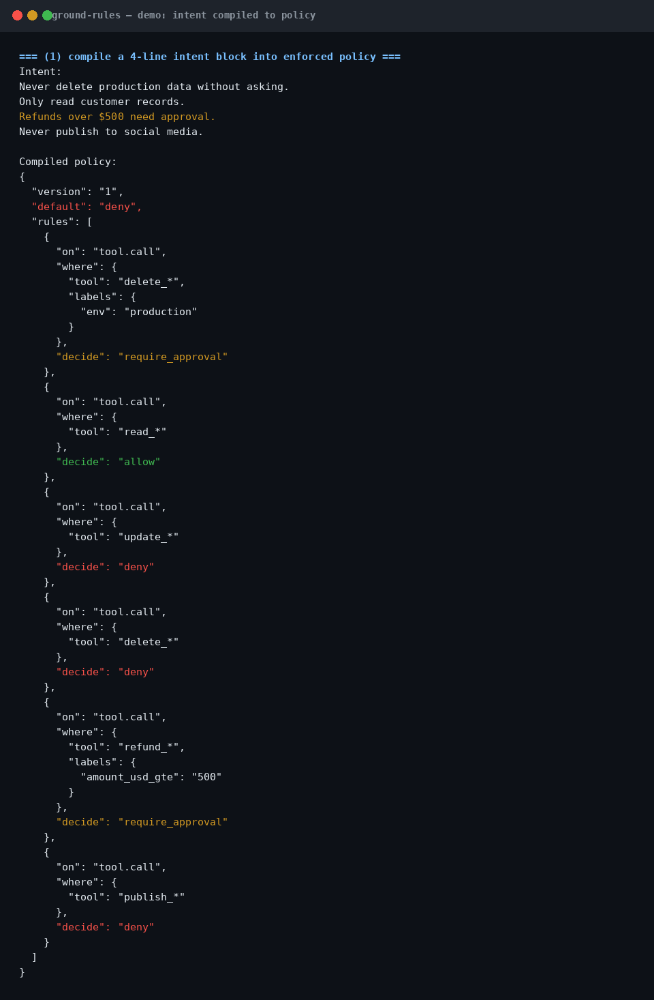
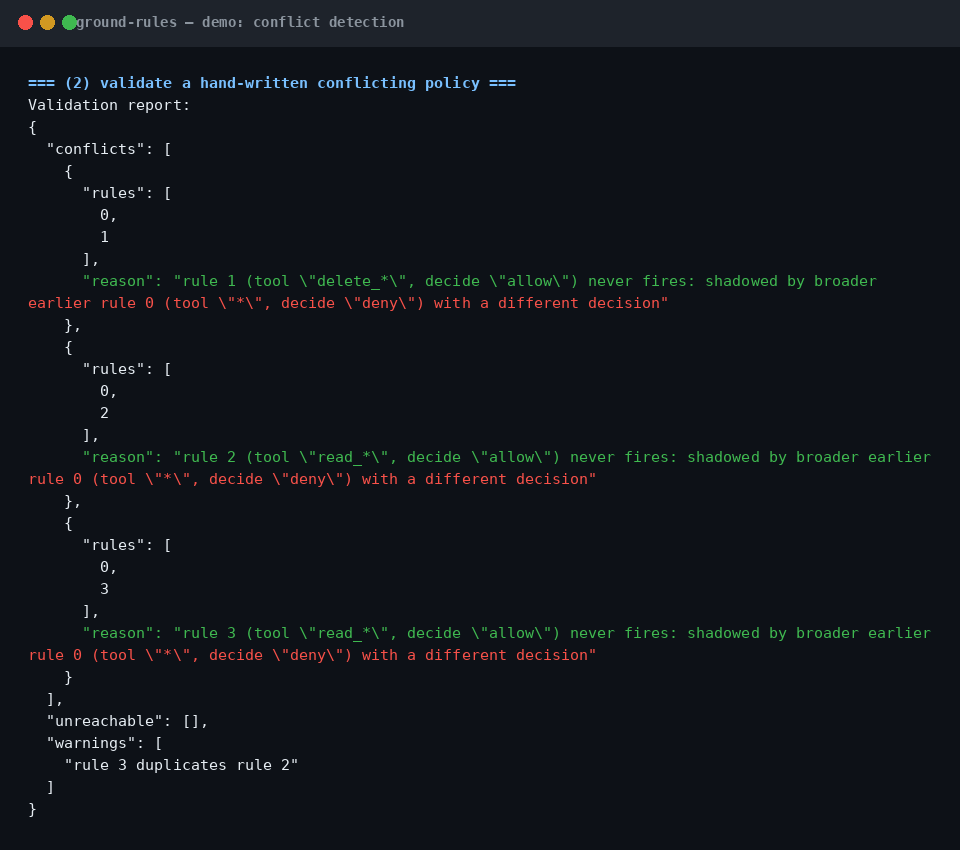

# ground-rules

[](https://github.com/richardsondx/ground-rules/actions/workflows/ci.yml)
[](LICENSE)

Set the ground rules for your agent, in plain language, and get back policy a machine can enforce.

## The problem

- Intent lives in system prompts, where it rots: nobody versions it, nobody tests it, and it silently changes meaning across model upgrades.
- Every framework migration drops your safety rules on the floor, because the rules were hand-wired to the old framework's hooks.
- "Be careful with production" is not enforceable. A rule the runtime cannot evaluate is a wish.
- What you need is intent compiled to versioned policy, validated for conflicts, then enforced by a gate.

## How it works

```text
Human intent ("never touch production without asking")
        │
        ▼
   ground-rules
   compileRules() → policy JSON     validatePolicy() → conflicts, unreachable, warnings
        │
        ▼
Validated policy { version: "1", default: "deny", rules: [...] }
        │
        ▼
   callgate (or any gate speaking this shape) enforces it before every tool call
```

## Install

```sh
npm i ground-rules
```

Zero runtime dependencies.

## Quickstart

```ts
import { compileRules, validatePolicy } from "ground-rules";

const policy = compileRules([
  "Never delete production data without asking.",
  "Refunds over $500 need approval.",
].join("\n"));

const report = validatePolicy(policy);
if (report.conflicts.length > 0) throw new Error("fix policy conflicts first");
```

That compiles to: `require_approval` on `update_*` labeled `env=production`, and `require_approval` on `refund_*` labeled `amount_usd_gte=500`.

## Where it fits

ground-rules is the compiler; [callgate](https://github.com/richardsondx/callgate) is the enforcer. The policy shape is shared and documented below, so any gate that speaks it can enforce what ground-rules compiles, with no dependency between the two packages.

The validator is the safety case. Compilers make mistakes, human-written policies doubly so, and model-generated policies triply so. `validatePolicy` catches the failure classes that hurt: two rules that contradict each other, a rule shadowed by an earlier broader rule so it never fires, and risky shapes like allowing every tool. A conflicting policy is worse than no policy, because it looks safe.

## Screenshots





## API reference

```ts
import { compileRules, validatePolicy, compileWithModel } from "ground-rules";
```

**`compileRules(text: string): CompiledPolicy`**
Deterministic, offline, no LLM. Splits input on newlines and periods, then applies pattern handlers per clause:

| Phrasing | Compiled rule |
|---|---|
| `never <verb> ...` | `deny` on the verb's tool glob |
| `never <verb> ... without asking` | `require_approval` (not deny) |
| `<verb> ... needs approval` / `ask me before <verb>` | `require_approval` |
| `only read <thing>` | `allow read_*` + `deny update_*` + `deny delete_*` |
| `over $N` / `above $N` / `more than $N` | adds label `amount_usd_gte: "N"` |
| `escalate ... to <target>` | `escalate` with `to: "<target>"` |
| `redact ...` | `redact` |

Verbs map to tool globs: read/fetch/search → `read_*`, delete/drop/destroy → `delete_*`, modify/change/update/write/touch → `update_*`, publish/post/deploy → `publish_*`, send/email → `send_*`, refund/charge/pay → `refund_*`/`charge_*`/`pay_*`. Unknown verbs fall back to `tool: "*"` with a `broad matcher` warning. The word `production` adds the label `env: "production"`.

**`validatePolicy(policy): { conflicts, unreachable, warnings }`**
- `conflicts`: an earlier rule whose scope subsumes a later rule's scope with a different decision, so the later rule can never fire. Each conflict names both rules and the reason. A narrower earlier rule followed by a broader later rule is the standard exception pattern and is not flagged.
- `unreachable`: rules fully shadowed by an earlier broader rule, so they never fire under first-match-wins evaluation.
- `warnings`: overly broad `allow` on `tool: "*"`, empty policies, exact duplicate rules.

**`compileWithModel(text, model): Promise<CompiledPolicy>`**
For phrasing the deterministic compiler does not cover. Sends a schema-constrained prompt (shape + two few-shot examples + your text) to your model function, parses the JSON, normalizes it, runs `validatePolicy`, and throws an error listing every conflict if any exist.

### Policy shape (shared with callgate)

```ts
{
  version: "1",
  default: "deny",
  rules: [{
    on: "tool.call",
    where: {
      tool: "read_*",                    // glob: "*" matches all
      reversibility: "irreversible",     // optional
      risk: { gte: 0.9 },                // optional
      labels: { env: "production" }      // optional, gate-evaluated conditions
    },
    decide: "allow" | "deny" | "require_approval" | "redact" | "defer" | "escalate" | "simulate",
    to: "security-oncall"                // only with "escalate"
  }]
}
```

## Limits

- The deterministic compiler handles common phrasings. Novel language needs `compileWithModel` with your own LLM, and the validator decides whether the result ships.
- Label-based numeric conditions (`amount_usd_gte`) are carried in the policy but must be evaluated by the enforcing gate.
- The validator detects conflicts where one matcher subsumes another. Partial-overlap edge cases between unrelated globs are not flagged.
- Globs are deliberately coarse (`read_*`, `delete_*`). Fine-grained tool identity belongs in the gate's manifest layer, not in compiled intent.

## For AI agents

- [`llms.txt`](llms.txt): the whole library in under 60 lines, install command and quickstart first.
- [`skills/ground-rules/SKILL.md`](skills/ground-rules/SKILL.md): a skill manifest so coding agents load this library when the task involves agent constraints or approvals.

## License

MIT. See [LICENSE](LICENSE).
